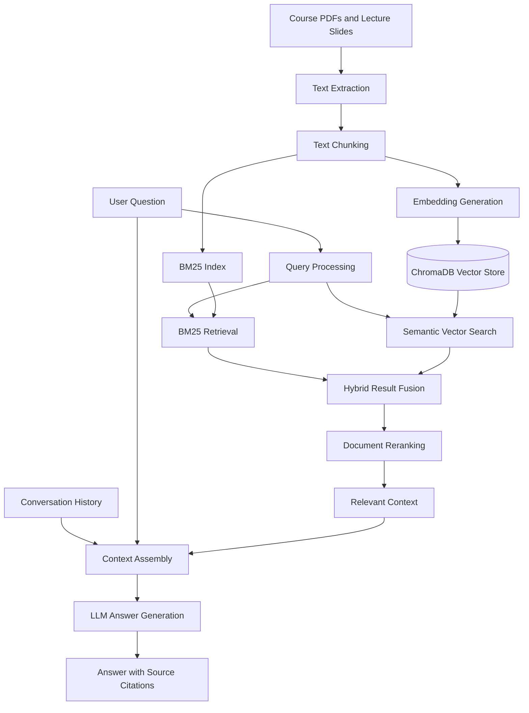

# 🎓 CourseGPT — AI Teaching Assistant

**An AI-powered teaching assistant that answers course-specific questions using Retrieval-Augmented Generation (RAG), hybrid search, reranking, and source-grounded responses.**

CourseGPT helps students understand course materials by retrieving relevant information from lecture PDFs and slides and using that context to generate accurate, contextual answers with source citations.

Instead of relying entirely on an LLM's pretrained knowledge, CourseGPT grounds its responses in the provided educational documents, making answers more relevant, transparent, and useful for academic learning.

---

## ✨ Key Features

- **📚 Document-Based Question Answering:** Ask questions directly from course PDFs, lecture notes, and presentation slides.
- **🔍 Semantic Vector Search:** Generate embeddings from document chunks and store them in ChromaDB to retrieve contextually relevant information.
- **⚡ Hybrid Retrieval:** Combine BM25 keyword-based retrieval with semantic vector search to capture both exact keyword matches and conceptual relevance.
- **🎯 Intelligent Reranking:** Reorder retrieved passages based on their relevance to the user's query before passing them to the language model.
- **🧠 Conversation Memory:** Maintain conversational context across follow-up questions for more coherent, context-aware responses.
- **🔗 Source Citations:** Associate generated answers with retrieved document sources to improve transparency and help users verify information.
- **🚀 FastAPI Backend:** Expose the question-answering pipeline through API endpoints for efficient integration with a frontend.

---

## 🏗️ System Architecture

CourseGPT follows a Retrieval-Augmented Generation (RAG) pipeline that connects document processing, information retrieval, and LLM-based answer generation.



### How It Works

1. **Document Ingestion:** Extract text from course PDFs and lecture slides.
2. **Text Chunking:** Split extracted content into manageable chunks to support focused retrieval.
3. **Embedding Generation:** Convert document chunks into vector representations that capture semantic meaning.
4. **Indexing:** Store embeddings in ChromaDB and prepare a BM25 index for keyword-based retrieval.
5. **Hybrid Retrieval:** Retrieve candidate passages using both lexical matching and semantic similarity.
6. **Reranking:** Reorder candidate passages to prioritize the most relevant context for the question.
7. **Context Assembly:** Combine the retrieved passages with relevant conversation history.
8. **Answer Generation:** Provide the question and selected context to the LLM to generate a grounded response.
9. **Source Attribution:** Track the source documents associated with the retrieved passages and present citations with the answer.

---

## 🛠️ Tech Stack

| Technology | Purpose |
|---|---|
| Python | Core application logic and RAG pipeline |
| FastAPI | Backend API and request handling |
| ChromaDB | Vector storage and semantic retrieval |
| BM25 | Keyword-based document retrieval |
| Embedding Models | Convert text into vector representations |
| Large Language Models (LLMs) | Generate context-aware answers |
| Reranking Model | Improve the relevance of retrieved passages |
| PDF / Slide Processing | Extract educational content from documents |

*Add the exact embedding model, LLM provider, reranker, and frontend technologies used in your implementation.*

---

## 📂 Project Structure

A suggested structure for organizing the project:

```text
CourseGPT/
├── app/
│   ├── main.py              # FastAPI application entry point
│   ├── ingestion/           # Document loading and text extraction
│   ├── retrieval/            # BM25 and vector retrieval
│   ├── reranking/            # Retrieved passage reranking
│   ├── generation/           # LLM answer generation
│   ├── memory/               # Conversation history management
│   └── citations/            # Source attribution and citation logic
├── data/
│   └── documents/            # Course PDFs and lecture slides
├── tests/                    # Unit and integration tests
├── .env.example              # Environment variable template
├── .gitignore
├── requirements.txt
└── README.md
```

*This is an illustrative structure. Adjust the folders and filenames to match your actual repository.*

---

## ⚙️ Getting Started

### Prerequisites

- Python 3.10+
- pip
- API credentials for your selected LLM provider, if required

### 1. Clone the Repository

```bash
git clone <YOUR_GITHUB_REPOSITORY_URL>
cd CourseGPT
```

### 2. Create a Virtual Environment

```bash
python -m venv .venv
```

Activate it:

**Windows**
```bash
.venv\Scripts\activate
```

**macOS / Linux**
```bash
source .venv/bin/activate
```

### 3. Install Dependencies

```bash
pip install -r requirements.txt
```

### 4. Configure Environment Variables

Create a `.env` file in the project root and add the variables required by your implementation.

```env
LLM_API_KEY=your_api_key_here
```

Add other configuration values as needed for your embedding model, LLM provider, and storage setup.

**Security:** Never commit API keys, credentials, or private course documents to a public repository.

### 5. Add Course Materials

Place your supported course PDFs and lecture slides in the configured document directory, or upload them through your document ingestion interface if one is implemented.

Run the project's ingestion process to extract text, create chunks, generate embeddings, and index the documents.

### 6. Start the FastAPI Server

If `app/main.py` exposes the FastAPI instance as `app`, run:

```bash
uvicorn app.main:app --reload
```

Open the interactive API documentation at:

```text
http://127.0.0.1:8000/docs
```

*Use the actual entry point and ingestion commands defined in your repository.*

---

## 💡 Example Use Case

**Scenario:** A student uploads lecture notes for a course and asks a question about a concept discussed in the material.

**User question:**
> Explain the key concepts discussed in Lecture 3 and how they relate to Lecture 2.

**CourseGPT workflow:**
- Searches the indexed course material using BM25 and semantic similarity.
- Reranks retrieved passages to identify the most relevant evidence.
- Uses conversation history when resolving follow-up questions.
- Generates an answer grounded in the retrieved course content.
- Provides source citations so the student can locate and verify the relevant material.

The final response depends on the documents indexed and the capabilities of the configured LLM.

---

## 🧠 Technical Highlights

### Hybrid Search: BM25 + Semantic Retrieval

BM25 is effective at finding exact terms, technical keywords, and phrases. Semantic vector search helps identify conceptually related passages even when the wording differs.

Combining these retrieval methods helps CourseGPT handle a wider variety of academic questions than relying on either approach alone.

### Reranking for Better Context Selection

Initial retrieval produces candidate passages. A reranking stage evaluates their relevance to the question and prioritizes the most useful context for answer generation.

This helps reduce irrelevant context reaching the LLM and can improve the quality of generated answers.

### Conversation Memory

Conversation memory allows the system to interpret follow-up questions in the context of earlier messages.

For example, after asking about a concept, a student can ask, "Can you explain that with an example?" without necessarily repeating the original topic.

### Source-Grounded Answer Generation

CourseGPT uses retrieved document passages as supporting context for the LLM. Source tracking connects the answer to its underlying documents, allowing students to verify information rather than relying solely on an unsupported generated response.

---

## 🔮 Future Improvements

- Support additional file formats, including DOCX and TXT.
- Add streaming responses for a more interactive learning experience.
- Introduce user authentication and course-specific workspaces.
- Add document-level and page-level citation links.
- Evaluate retrieval quality using Recall@K, MRR, and nDCG.
- Evaluate answer faithfulness and relevance using a curated question-answer dataset.
- Optimize indexing, retrieval latency, and response generation for larger course collections.
- Add automated tests and monitoring for retrieval and generation quality.

---

## 🎯 Project Goals

CourseGPT explores how Retrieval-Augmented Generation can make LLM-based educational assistants more useful by combining:

- Document-grounded knowledge retrieval.
- Hybrid lexical and semantic search.
- Relevance-based reranking.
- Context-aware conversational interactions.
- Transparent source attribution.

The goal is to help students interact with their own learning materials through a more relevant, contextual, and verifiable question-answering experience.

---

## 👨‍💻 Author

**Tanmay S Sagar**


*Built to explore practical applications of RAG, information retrieval, and LLM-powered educational tools.*
